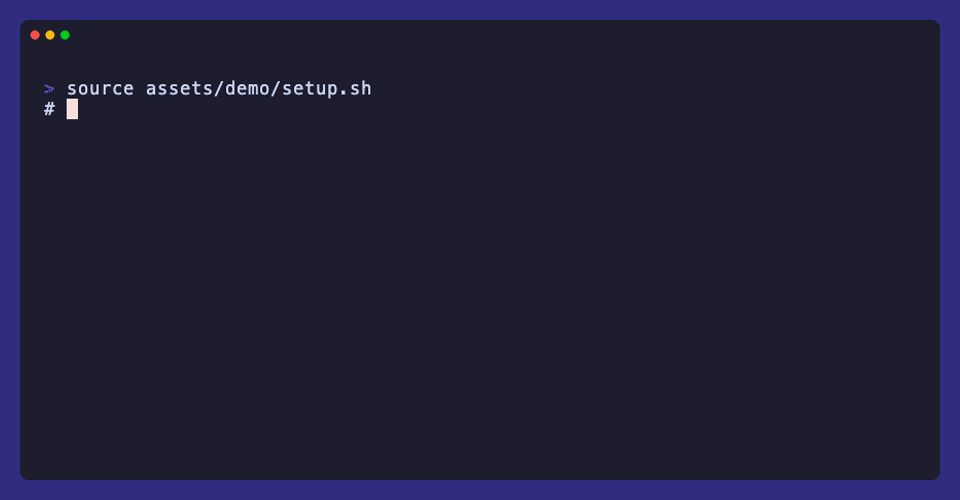

<div align="center">

# ccmorph

**Every Claude Code account, API key and gateway behind one command.**

[Install](#install) · [Quick start](#quick-start) · [Usage](#usage) · [Docs](docs/guide.md)



</div>

## Highlights

- **One profile per backend.** Each subscription, API key or gateway gets its own
  login, settings and session history. Skills, plugins, hooks and `CLAUDE.md`
  stay shared.
- **Hop mid-session.** `ccmorph hop <profile>` moves a running conversation to
  another profile, keeping its model and effort.
- **Any endpoint.** Gateways that do not speak Anthropic's API are translated
  automatically through a per-launch adapter.
- **Cost per profile.** Every gateway turn leaves a receipt with the billed cost;
  [ccusage](https://github.com/ccusage/ccusage) turns them into daily reports.
- **Leaves `claude` alone.** No wrapper, no patch: native arguments pass through.
  See [Scope and ownership](docs/ARCHITECTURE.md#scope-and-ownership).

```
                   +--> work       subscription login  -->  Anthropic
ccmorph run  ------+--> personal   API key             -->  Anthropic API
                   +--> gateway    API key             -->  any other model API
                                                            (translated for you)
```

## Requirements

- `zsh`, `python3` 3.8 or newer, and the `claude` CLI. The installer names the
  command to install a missing one for your package manager, and stops.
- A release ships `gateway-shim` prebuilt for macOS and Linux (arm64, amd64).
  Installing from a clone needs Go to build it (`make shim`).
- Optional: `cliproxyapi` for non-Anthropic endpoints, `fzf` for searchable
  pickers. The installer offers fzf through your package manager and
  cliproxyapi through Homebrew, and installs only on confirm.
- macOS or Linux. On Windows, use WSL.

## Install

With Homebrew (macOS arm64 and Linux x86_64 get a prebuilt bottle, so no Go):

```sh
brew install akleizor/tap/ccmorph
ccmorph doctor
```

Type the full `akleizor/tap/ccmorph` name: Homebrew trusts a third-party tap's
formula only when it is named that way. Upgrade with `brew upgrade ccmorph`.

From a clone:

```sh
git clone https://github.com/akleizor/ccmorph && cd ccmorph && make shim && ./install.sh
```

Or the one-liner, which works once the repository is public and has a release —
it is private today, so the download returns 404:

```sh
sh -c "$(curl -fsSL https://github.com/akleizor/ccmorph/releases/latest/download/install.sh)"
ccmorph doctor
```

The one-liner installs the latest release: it downloads that release's
`ccmorph.tar.gz` and runs its installer. `CCMORPH_REF` (a branch or tag)
installs unreleased code from the GitHub archive of that ref — `CCMORPH_REF=main`
for the bleeding edge — and `CCMORPH_INSTALL_URL` replaces the whole tarball URL.
`curl -fsSL ... | sh` also works, but it has no terminal to ask on, so it declines
the optional installs and prints the commands instead.

The installer copies the runtime (`lib/`, `libexec/`, `share/`) into `~/.config/ccmorph` and the `ccmorph`
command into `~/.local/bin`. It never edits shell startup files; if
`~/.local/bin` is not on your `PATH`, it prints the line to add, for your shell.

To update, run `ccmorph update` (the latest release; `ccmorph update <branch-or-tag>`
for another), or run the same install again; profiles, credentials, and `local.sh`
are preserved. A git clone is updated with git instead. `ccmorph uninstall` removes the command and
leaves your profiles alone.

## Quick start

A fresh install has no profiles.

```sh
ccmorph doctor           # check zsh, python3, claude and PATH
ccmorph add work         # create a profile: login or credential paste
ccmorph run              # launch Claude Code on it
```

The first profile you add becomes the default. `ccmorph list` shows the
profiles with the default marked, and `ccmorph use <profile>` changes it.

## Usage

```sh
ccmorph run <profile>              # launch on a profile for this session
ccmorph use <profile>              # make a profile the default for `ccmorph run`
ccmorph run -i                     # choose the profile, then the model
ccmorph run <profile> --model <id> # profile plus explicit model
ccmorph run work mcp list          # native Claude Code arguments pass through
ccmorph config <profile>           # change model, reasoning, or connection
ccmorph set <profile> model -i     # save a default model, chosen from the endpoint
ccmorph inspect [<profile>]        # effective settings and where each came from
ccmorph doctor [<profile>]         # check why a profile is not working
```

To switch a running session, use a leading `!` in the Claude Code prompt:

```
! ccmorph hop personal
```

`ccmorph --help` shows everyday commands, `ccmorph help all` the full list, and
`ccmorph help <command>` the details of one.

## Usage and cost

Each turn a gateway profile serves writes one receipt under
`~/.local/state/ccmorph/usage/`: tokens, the model that answered, and the
cost the gateway billed when it reports one (for a provider reached directly,
the cost at its models.dev price). No prompt, header or credential is
stored. Export the receipts and read them with ccusage:

```sh
scripts/usage-export --output ~/.cache/ccmorph-usage
CLAUDE_CONFIG_DIR=~/.cache/ccmorph-usage ccusage claude daily --instances \
  --config ~/.cache/ccmorph-usage/ccusage.json
```

Each profile is one ccusage project. A billed cost is used as is; a turn the
gateway did not price is priced by ccusage at the provider's list price.
Subscription profiles talk to Anthropic directly and write no receipts.

## Configuration

A profile is one file, `~/.config/ccmorph/<name>.conf`, of `key=value` lines;
`profile.conf.example` is the template and lists every allowed key. Runtime state
lives under `~/.config/ccmorph/profiles/<name>`. The state root is
`$CCMORPH_STATE_DIR`, else `$XDG_CONFIG_HOME/ccmorph`, else `~/.config/ccmorph`.
Use `ccmorph rm` and `ccmorph mv` rather than editing files by hand.

Common keys: `type`, `base_url`, `api_key`, `model`, `effort`,
`excluded_models`, and `context_window.<model>`. To reach a private endpoint,
export `HTTPS_PROXY` for the command; ccmorph passes it through unchanged.

The [user guide](docs/guide.md) covers every setting, gateway behavior, context
windows and probing, switching, and state migration.

## Documentation

| Doc | Covers |
|---|---|
| [docs/guide.md](docs/guide.md) | Full usage and configuration reference |
| [docs/ARCHITECTURE.md](docs/ARCHITECTURE.md) | How sessions reach a backend, and why |
| [.github/SECURITY.md](.github/SECURITY.md) | Where credentials live and what protects them |
| [CHANGELOG.md](CHANGELOG.md) | What changed in each version |
| [addons/remote-control/README.md](addons/remote-control/README.md) | Remote Control bridge add-on |

## Tests

```sh
make test
```

CI runs the same suites on Linux and macOS (`.github/workflows/ci.yml`).

## License

MIT — see [LICENSE](LICENSE).
